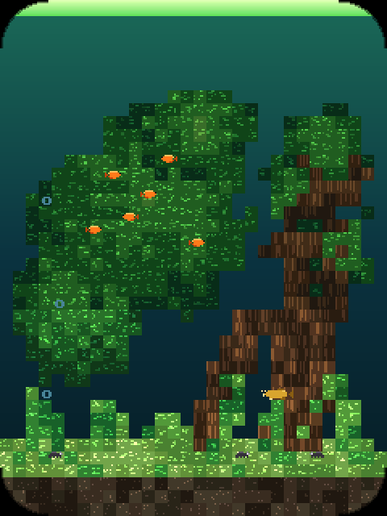

# ASCII 鱼缸 · AI Passport 独立玩法

把 FoloToy AI Passport（ESP32-C3，240×320）变成一个小小的桌面水草缸：

- **底图是像素画**：后景小宝塔、中景叉柱花与小水榕、前景牛毛毡与天胡荽、沉木、水草泥，全部烘进一张 8bpp 索引位图（76.8 KB，放 Flash）
- **三种生物**：喷火灯 ×6 中层成群、黄金胡子 ×1 贴沉木慢游会停顿、黑壳虾 ×3 在草皮上爬、食物落底才冲
- **字符层只留动态**：气泡与鱼食碎屑

这是 `feature/ascii-aquarium-smoke` 分支上的完整应用 —— **整个固件就是鱼缸**，不经过开发板的 demo 菜单。刷进来之后，开机即鱼缸。



> 这是按固件同一套参数（同一份字模、同一组精灵像素、同样的渐变与圆角遮罩）离线重绘的示意图，不是真机照片。真机上边缘是 1:1 硬边，比这张图更锐利。

## 怎么玩

| 操作 | 行为 |
| --- | --- |
| **OK** 短按 / 长按 | 投喂。每次撒 1–4 粒，落点和下落速度随机 |
| **UP** 短按 | 背光调亮一档（20% 一档，最高 100%） |
| **DOWN** 短按 | 背光调暗一档（最低 20%） |
| **电源键** 长按约 2 秒 | 关机（硬件行为，与固件无关） |

没有「返回菜单」这个动作：在这一平台上，一个玩法就是整个固件。换玩法＝重新烧录；想回到原厂固件＝扫机身背面二维码走官方恢复流程。

## 省电行为

固件按「多久没人按键」自动降档，任何按键立即回到满档：

| 空闲时长 | 状态 | 行为 |
| --- | --- | --- |
| < 30 秒 | 满档 | 约 55 fps |
| ≥ 30 秒 | 降帧 | 15 fps，画面仍在动 |
| ≥ 2 分 30 秒 | 息屏 | 停止渲染，背光降到 0 |

模拟始终按 30 Hz 墙钟推进，所以降帧只影响画面刷新，不会让鱼游得更慢 —— 从息屏唤醒时鱼的位置是连贯的。

## 构建与烧录

需要 ESP-IDF **v5.5.3**（ESP32-C3 目标）。环境准备见 [`docs/development/engineering/environment-setup.md`](docs/development/engineering/environment-setup.md)。

```bash
source <esp-idf>/export.sh

# 编译 + 校验合并镜像（推荐）
./tools/validate.sh --firmware

# 分段烧录：只写 bootloader / 分区表 / app，保留 NVS
idf.py -p /dev/cu.usbmodem101 flash

# 或烧合并镜像到 0x0（会连带清空 NVS）
python -m esptool --chip esp32c3 -p /dev/cu.usbmodem101 -b 460800 \
  --before default_reset --after hard_reset write_flash \
  --flash_mode dio --flash_size 8MB --flash_freq 80m \
  0x0 build/FoloToy-AI-Passport-full.bin

# 看串口日志
idf.py -p /dev/cu.usbmodem101 monitor
```

也可用官网的浏览器刷机器刷本地 `.bin`：<https://ai-passport.folotoy.cn/tools/web-flasher/>（Chrome/Edge，文件不上传）。

## 代码结构

| 文件 | 职责 |
| --- | --- |
| `main/main.c` | 应用入口：初始化显示与按键，启动鱼缸；不含菜单 |
| `main/aquarium.c/.h` | 场景合成、底图 + 字符层 + 精灵层渲染、双缓冲推屏、省电节拍 |
| `main/aquarium_bg.c/.h` | **生成物**：8bpp 索引底图与调色板（由脚本生成，勿手改） |
| `main/sprites.c/.h` | 三种生物的字符画素材 + 通用 blit（裁剪/镜像/透明，纯逻辑可测） |
| `main/fish_sim.c/.h` | 生物状态机：定点 Q8、按种类的层带与速度、避让/追食/停顿，纯逻辑可测 |
| `main/idle_policy.c/.h` | 省电策略状态机，纯逻辑可测 |
| `main/ascii_font.c/.h` | 8×8 ASCII 点阵字模（公有领域），95 字形共 760 字节 |
| `tools/gen_background.py` | 底图生成器：程序化布局，或读 Aseprite 导出的 8bpp 索引色 PNG |
| `tests/test_fish_sim.c` | 14 项：不出界、可复现、层带、虾只认落底食物、胡子停顿 |
| `tests/test_sprites.c` | 5 项：尺寸、透明、镜像对称、越界裁剪 |
| `tests/test_idle_policy.c` | 省电门限与帧率映射 |

## 设计取舍（都是真机上踩出来的）

- **不用 LVGL**：面板由渲染任务独占。早期版本把鱼缸挂在 demo 菜单里、和 LVGL 共用同一块面板，LVGL 的刷屏完成信号被我们的直写抢走，状态机卡在「刷新中」，退出页面时菜单画不出来，表现为死机。
- **底图用索引位图而不是字符画**：240×320 的植物/沉木/底床有几十档明暗，字符装不下；8bpp 索引图 76.8 KB 放 Flash，运行时不占 RAM，明暗在生成阶段就烘进像素，设备端只做一次查表。
- **底图由脚本生成**：`tools/gen_background.py` 把草图里的布局算法（blob / stroke / 草皮 / 空洞填充）移植成 Python，随机序列与草图一致；换成 Aseprite 手绘时用 `--from-png` 直接吃索引色 PNG。
- **字符 + 精灵混合**：气泡、鱼食用字符，三种生物用像素精灵。8 像素一格下，字符永远拼不出鱼形。
- **三种生物各有层带**：喷火灯的层带是软的（追食可越界俯冲），虾是硬的（永远不离开草皮）。硬层带不追半空中的食物，等落底才冲 —— 这也是"虾最后登场"的来源。
- **食物有发现延迟**（3 秒）：不加延迟时食物一出现就被抢光，看不到下沉；3 秒是标定出来的折中（3.7 秒吃完，偶尔能落到底让虾有戏）。
- **气泡要压暗**：没有 alpha 通道，只能靠明度把气泡压进水里，否则像发光点。
- **动画行有预算**：常驻动画 = 精灵覆盖行 ∪ 气泡行 ∪ 摆动行，上限 22 行（共 40 行）。
  超了先砍摆动，精灵和气泡照常 —— 实测动画行全开时 `work` 会翻倍，这条上限是防回退的保险。
- **摆动只在相位变化那一帧标脏**：摆动每 16 个 tick（30 Hz）才换一档，没必要每帧重绘。
- **行级脏检测 + 精灵覆盖行强制重绘**：只推变化的行把每帧传输量从 153 KB 降到几 KB；但字符网格的脏检测看不见精灵，鱼走过的行必须强制重画，否则留下残影。
- **传输串行等待**：写缓冲区前先等这一块上一次的 DMA 传完。用时间戳估算队列在帧率升高时会偏小，等于往正在被 DMA 读的内存里写 —— 满屏噪声。
- **颜色打包要换字节序**：面板要求高字节先发，直接推小端 `uint16_t` 会让橙色显示成浅蓝、深蓝水变成紫红。
- **圆角自己画**：BSP 的圆角是 LVGL 刷屏时做的，绕过 LVGL 后要在填像素时按四分之一圆遮罩，并留一像素抗锯齿。
- **尾巴用行波**：四帧、相位沿身体到尾部递增，看起来是「甩」而不是整块三角翻转。

## 已知限制

- 没有深睡：息屏只是停渲染 + 关背光，主控仍在运行；如果要按天数的续航，需要接 `esp_sleep` 并处理按键唤醒守卫。
- 水草基本静止：只有 3 丛前景草尖会左右摆（周期约 4.3 秒、幅度 2 px）。大面积水草的
  整行位移试过并回退了 —— 帧时间从 8.4 ms 涨到 19.8 ms 触发看门狗，而且整片一起晃会晕。
- 没有光柱：做过最小版（1 道、固定强度、只作用水像素、夜间自动关闭），实测观感不好已移除；
  草图里的三道光束如果要再做，得先解决"光柱被水草遮挡时边缘很硬"的问题。
- 夜间模式是"换调色板"级的最小实现：水体与底图整体压暗偏蓝、喷火灯提亮 1.9 档，没有光晕。
  背光降到最低档（25%）自动进入，调亮即退出。
- 生物只有左右镜像，没有上下翻转；垂直游动时仍是侧视。
- 鱼只有左右两个朝向的镜像，没有上下翻转：垂直移动时鱼仍保持侧视。
- 屏幕的 TE 同步脚没有接到 MCU，理论上无法做到完全无撕裂；当前用行级增量刷新把可见撕裂压到了看不见的程度。

## 许可与来源

- 固件基于 [FoloToy/ai-passport](https://github.com/FoloToy/ai-passport)（MIT），BSP 与构建基线来自该项目。
- 8×8 字模取自 [font8x8](https://github.com/dhepper/font8x8)（Daniel Hepper，Public Domain）。
- 本项目为社区玩法，与 FoloToy、腾讯均无隶属关系。
